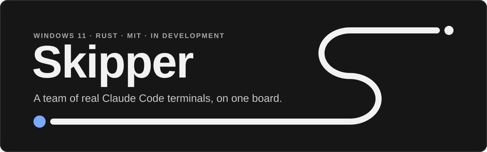
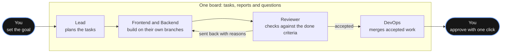
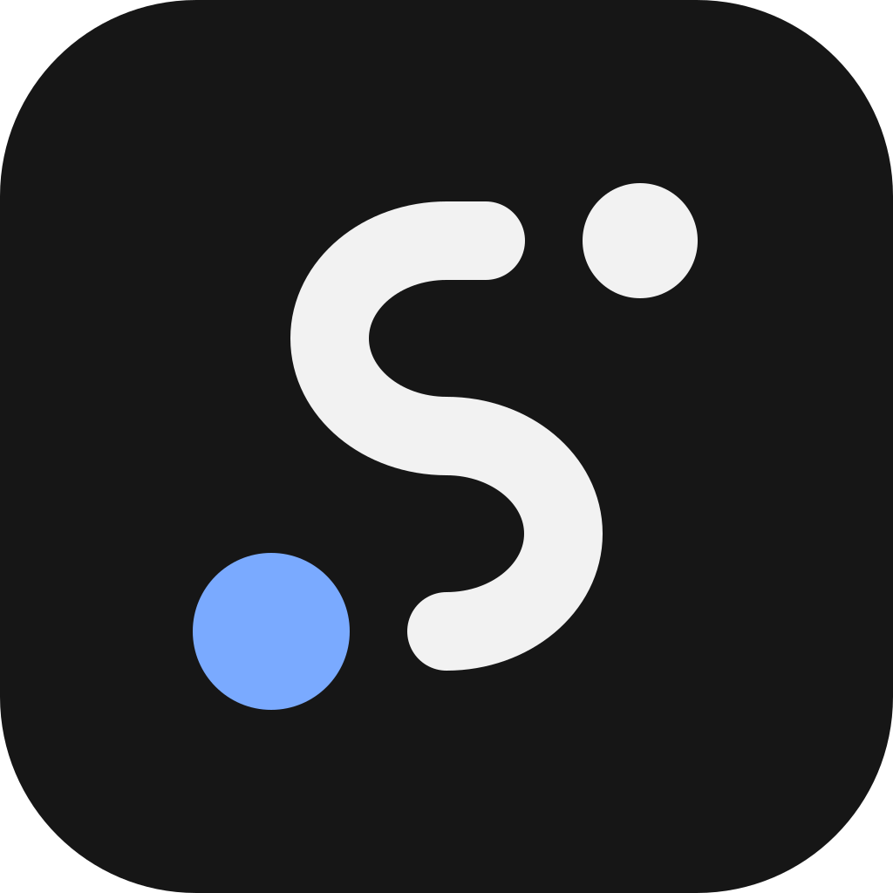

<div align="center">

<a id="skipper"></a>

<picture>
  <source media="(prefers-color-scheme: dark)" srcset="docs/brand/readme/hero-dark.svg">
  <source media="(prefers-color-scheme: light)" srcset="docs/brand/readme/hero-light.svg">
  
</picture>

**A desktop app for Windows that runs a team of real Claude Code sessions.**<br>
Every role is a visible terminal, the work runs through one board, and resource limits and account rules are part of the program. In development, not released yet.

[](LICENSE) [](#planned-requirements) [](https://www.rust-lang.org/) [](#what-is-built-today) [](https://discord.gg/9kggrpKCvQ) [](https://x.com/Skipper_OS)

[At a glance](#at-a-glance) · [What is built](#what-is-built-today) · [How it works](#how-it-works) · [Accounts](#accounts) · [Requirements](#planned-requirements) · [Where to get Skipper](#where-to-get-skipper) · [Roadmap](#roadmap) · [Read more](#read-more) · [Community](#community) · [Contributing](#contributing) · [License](#license)

</div>

> **Status as of 0.1.0-test.9 (2026-11-11): in active development, not released. There is nothing to install yet.**
> This repository holds the documents, the project rules and the check tool (`xtask/`). The Rust source code follows step by step in small reviewed pull requests, so most of what these pages describe is not public yet; [docs/code-arrival.md](docs/code-arrival.md) says how it arrives. The current version is 0.1.0-test.9, a test build for the project's own testing that is not published. The features on this page are the 1.0 plan and may still change; [What is built today](#what-is-built-today) says which of them exist in code. Windows only.
>
> **What you can do today.** Read the documents, ask a question or give design feedback in an issue, and watch the repository. Pull requests are not open yet (see [CONTRIBUTING.md](CONTRIBUTING.md)). Paths that these documents name, such as `crates/`, `docs/design/`, `docs/probes/` and `.github/workflows/`, do not exist here yet.

Skipper is a desktop app for Windows, in development, that runs a team of real Claude Code sessions. Every team member is a role, and every role is a real, visible Claude Code terminal in its own panel. A lead role hands out work, other roles build, research and check it, and a person gives the final approval.

Skipper is an independent open-source project. It is not affiliated with, endorsed by or sponsored by Anthropic. Claude and Claude Code are trademarks of Anthropic. Skipper is also unrelated to other software with the same name. Skipper runs with Claude Code: its own code is written in Rust, it runs the unmodified Claude Code you installed yourself, and you sign in with your own account.

## At a glance

Six things to know about Skipper. The small label under each one says how far it has come.

<table>
<tr>
<td width="33%" valign="top">
<br>
<b>Roles are real terminals</b><br>
Every role is a real Claude Code session in its own visible panel. You can look at it and type into it at any time.<br>
<sub>Built, code not yet public</sub>
</td>
<td width="33%" valign="top">
<br>
<b>One board</b><br>
Tasks, reports, questions and objections go through one shared board, kept as plain files. Every task has one owner.<br>
<sub>Built, code not yet public</sub>
</td>
<td width="33%" valign="top">
<br>
<b>Limits you set</b><br>
Skipper scans your PC and suggests caps, in total and per role. Windows always keeps a reserve that is never zero.<br>
<sub>Built, code not yet public</sub>
</td>
</tr>
<tr>
<td width="33%" valign="top">
<br>
<b>You approve</b><br>
Only your click in Skipper's own window gives the final approval. A message from a role never counts as a yes.<br>
<sub>Built, code not yet public</sub>
</td>
<td width="33%" valign="top">
<br>
<b>Your account stays yours</b><br>
Skipper runs the Claude Code you installed yourself and never reads, stores, copies or sends your Claude credentials.<br>
<sub>By design</sub>
</td>
<td width="33%" valign="top">
<br>
<b>Native, in Rust</b><br>
Written in Rust for Windows 11 or newer. Docker is not required.<br>
<sub>Planned requirements</sub>
</td>
</tr>
</table>

<sub>"Built, code not yet public" means that the code and its automated tests exist (the source follows in this repository, documents first), not that a part is proven. "By design" marks a rule of the design. "Planned requirements" are what Skipper plans to need. Nothing is released yet; [What is built today](#what-is-built-today) lists every part.</sub>

> **How to read this page.** Marks in brackets such as (owner decision) or (maintainer's call) say who made a decision and who may change it; [GOVERNANCE.md](GOVERNANCE.md) explains them. "Built, code not yet public" and "By design" are explained under the six points above. A *probe* is a test on a real Windows machine that settles a statement nobody has proven yet; [docs/probe-guide.md](docs/probe-guide.md) says how one is run. Pointers to "the design document" mean a document that is not published yet: it follows with the code, and until then decisions are recorded in the issue or pull request that makes them. [SECURITY.md](SECURITY.md) explains the four hard locks and its other terms in plain words.

## Why

Running several Claude Code sessions as a team often ends in a pile of terminal windows, hand-written scripts, background processes that nobody sees, coordination by copy and paste, accounts shared without a clear rule, and a PC that runs out of memory.

Skipper aims to replace that with one program. You can see every role. The coordination runs through one board. The protection, the resource limits and the account rules are part of the program and are tested, not left to habit.

Skipper is not an AI agent of its own and makes no model calls. It does not replace the Claude Code terminal. It runs it.

## What is built today

Status as of 0.1.0-test.9 (2026-11-11). "Built, code not yet public" means that the code and its automated tests exist; the source follows in this repository, documents first. It does not mean proven: no probe counts yet, because the stage 1 checker (`cargo xtask stage1-check`, which runs once the code and the probe sheets are published) keeps every item open, and nothing is released. Everything else on this page is the 1.0 plan.

| Part | Status |
|---|---|
| Roles as real Claude Code terminals in panels, the role cards, the attention inbox and the saved layout | Built, code not yet public. |
| The starter team (eight roles) and the empty start | Built, code not yet public. |
| The board, the task board and the knowledge base | Built, code not yet public. |
| The final approval by a person's click, and the push check | Built, code not yet public. |
| Pacing, with holds on new starts | Built, code not yet public. On by default. The ninth test build starts in the mode "suggest"; later builds start in the mode "hold-fill". |
| Accounts shared with you, the weekly table and the weekly warnings | Built, code not yet public. Skipper never pushes an account that it sees you use outside Skipper, or that you mark as shared with a line in a file (there is no button for the mark yet). The Accounts page has a weekly table, and Needs you warns at 85 % and at 93 % of an account's week. |
| The hardware scan, the caps and the reserve | Built, code not yet public. |
| Model settings, and the automatic choice of model and effort | Built, code not yet public. The automatic choice is on by default. Each role card holds the limits of the choice: where the role's start row comes from, the lowest and highest model and effort, and when ultracode and ultrathink may start. |
| The protective box (job object and AppContainer) and its weaker fallback | Built, code not yet public. Its probes have not run, so every role card says "not verified". |
| Connections through Skipper, the vault and the sign-in helper | Built, code not yet public for servers on the internet. A local program through Skipper is refused for now. The Windows Hello layer is built but switched off until its probe (PRB-96) has run: the settings refuse the choice, and the saved sign-ins unlock with your Windows sign-in. |
| Import from files | Built, code not yet public for a folder or ZIP of Markdown or Obsidian files, a Notion export ZIP and a Trello export. An import can go into a new project. |
| The maintainer role for outside pull requests and issues | Built, code not yet public. |
| Several projects open at once | Built, code not yet public. |
| Automatic choice of account | Built, code not yet public. For a role whose account is set to automatic, Skipper picks one of your own signed-in accounts. |
| Continuing a role on another of your own accounts at a limit | In development, not released, not promoted. |
| Updates | Built, code not yet public. Skipper looks for updates by itself while the setting is on, which is the default. The release source is empty until the first release is published, so nothing is fetched from the network, and a test build only looks into a folder on your PC. |
| English and German, light and dark | Built, code not yet public. |
| Import from Linear, GitHub Issues or Notion through their services | Built, code not yet public, but never tried against the real service, so the tiles of Linear and GitHub Issues and the button for the Notion API carry the badge "new". The import window saves one sign-in for the import, and Skipper's sign-in helper reads the service. |
| Import from Jira Cloud through its service | Not built: the sign-in prompt has no place for the e-mail that Jira needs beside the token, so the import window hides Jira's sign-in step and an import from Jira cannot be started. |
| Flows (editable templates and the "Build cycle" starter flow), the timeline and the stall view | Not built. |
| Protection through Docker, WSL or an address filter | Not built. |
| Export as Markdown or CSV, and ready-made connection templates | Not built. |
| Skipper's own skills | 17 are written. None is shipped yet. |
| The per-user installer: a setup file, install and uninstall without administrator rights, and the repair of an update that was cut off | Built, code not yet public. See the [install guide](docs/install.md). |
| Code signing and a release | Not built. Nothing is published. |

## How it works

Everything in this section is the 1.0 plan and may still change. Nothing is released yet. The table above says which parts exist in code today.

### The main path of a task

You or the product role write the goal, and you give the final approval. In between, the roles of the starter team work through one board, and they do not share one conversation. The starter team has eight roles; the picture shows the main path of one task.



Only your click in Skipper's own window moves work into the main branch. The parts below explain each step.

### Roles are real terminals

A role is a named team member. Each role runs one real Claude Code session in a terminal inside Skipper's window, with its own panel, its own instructions and one account.

- You can arrange the panels freely: split them, stack them, detach them into their own windows or move them to a second screen. Skipper remembers the layout.
- A strip at the top shows one card per role: its state, its current task and how much of its account's usage is spent.
- You can look at any terminal and type into it yourself at any time. Nothing runs where you cannot see it.
- Starting the team is one click, and every role resumes its earlier conversation. A fresh start happens only when you ask for it.
- Closing a panel stops that role cleanly. Closing Skipper stops all roles. There is no background service.
- The attention inbox (the "Needs you" button in the header) collects everything that waits for a person: questions, approvals, permission prompts waiting in a terminal, accounts at their limit or near their weekly limit. It never answers anything by itself.

### A starter team, or an empty start

On the first run you choose "Start with the starter team (recommended)" or "Start empty". (owner decision) The starter team is a template of eight roles. Each one is ordinary content that you can rename, edit or delete, and none of them starts by itself.

| Role | Job | Writes product code? |
|---|---|---|
| Lead | Turns goals into tasks with clear done criteria, hands them out, settles objections, keeps the plan tidy, asks you when a decision is yours | No |
| Product | Keeps the list of goals, writes down what the end user should notice, checks finished work from the user's point of view | No |
| Frontend | Builds the user-interface part of a task on its own branch and reports with evidence | Yes |
| Backend | Builds the server, data and logic part of a task on its own branch and reports with evidence | Yes |
| Research | Answers open questions such as options, libraries and risks, and files the answer in the knowledge base | No |
| Reviewer | Checks reported work against the done criteria, independent of whoever built it | No |
| DevOps | Merges accepted work level by level up to the final approval, keeps the build and checks green, prepares the final approval for you | No |
| Maintainer | Looks after pull requests, issues and pushes that come from outside the team, asks the roles that a change concerns, and recommends an answer; you decide | No |

"Start empty" gives you no roles at all. Either way, Skipper ships no tasks, accounts or project knowledge, and nothing from any existing team. The instruction texts of the starter roles are written for Skipper and are yours to edit. The exact roles and rights are (maintainer's call) and may still change.

The lead does not write product code by default. That is a setting per role, through its file scope, and not a built-in rule, so you can allow it. File scope is a rule in Claude Code's hooks. It is not a lock in Windows, and the documentation will say so.

### One board and one knowledge base

Skipper has its own task board and knowledge base, so the team's work lives in one place. Both are built in and stored as plain files.

- **The board.** One shared message board for tasks, reports, questions, objections and notes. It is append-only: entries are added and never rewritten, so the history stays readable. Skipper's core is its only writer.
- **The task board.** Tasks in columns: needs you, inbox, open, in progress, review, rework and done. Every task has exactly one owner and a clear done criterion.
- **The knowledge base.** Readable pages with search and backlinks for decisions, how-tos, research results and lessons. The starter team comes with three pages: a team handbook, "how to write a task" and a glossary.

Roles do not share one memory or one conversation. They share one source of truth. On every start, a role gets a short briefing with its open tasks, the questions and objections first, and the latest decisions. A permissions table says who may hand out tasks, close other roles' tasks or approve a level. Only a person changes rights.

Roles reach the board through Skipper's own tools, which a role calls itself (a small local MCP server), and through Claude Code hook replies. Skipper never types into a session.

### The work cycle

The starter team works in one cycle. A person is involved at the start and at the end.

```
  goal -> plan -> build -> check -> integrate -> approve -> learn
   ^                ^        |                               |
   |                +-rework-+                               |
   +----------------------- next goal -----------------------+
```

1. **Goal.** You or the product role write a goal, with one sentence about what the end user will notice.
2. **Plan.** The lead splits the goal into tasks with done criteria and gives each task to one role. The research role answers open questions on the way.
3. **Build.** Frontend or backend works on its own branch in its own clone and reports with evidence: a commit and a test result.
4. **Check.** The reviewer checks the work against the done criteria and either accepts it or sends it back with reasons. If the same task is rejected three times, it is raised to the lead and then to you.
5. **Integrate.** DevOps merges accepted work up to the level before the final approval and runs the checks.
6. **Approve.** You give the final approval with one click in Skipper's own window. Nothing else can.
7. **Learn.** Product checks what the user would notice. Where something stalled, a lesson is written down. The lead updates the plan.

Today the cycle runs on the states of the task board. Later it is planned to ship as one editable starter flow called "Build cycle". A flow is a template of steps across roles that you can define yourself. Skipper calls them flows, not workflows, so they are not mixed up with workflows inside a single Claude Code session.

A flow that works badly is only an intermediate state. Skipper is meant to show where a flow stalls, make it easy to change that step, and keep what was learned as a lesson page. That is how the project measures its own success.

### Your machine: the hardware scan

Skipper scans the machine: cores, memory, graphics card and disk. From the scan it suggests limits, and you can change every value at any time, even while roles are running.

- A total cap for all roles together.
- A limit per role for memory and cores.
- A reserve that Windows always keeps. It can never be set to zero, and Skipper keeps a minimum that leaves the PC responsive.
- A live display of processor, memory and disk use per role, with a warning shortly before a limit.

The first suggestion is about 4 GiB of memory per role. Starting more roles than fit gives a warning, never a silent cut. As a rough guide, a 16 GB PC fits about three roles at once and a 32 GB PC about five. The graphics card is only shown at first.

### Models, effort and context

Model, effort and context size are set in one settings window, with a search field at the top and a short help text on every setting. Skipper can also choose model and effort for each start by itself (see "Automatic choice" below).

- **Per model.** A profile for each model that Claude Code accepts, with a default effort and a context limit. The context limit is the point at which Claude Code compacts the conversation. You can add a model by typing its name.
- **Per role.** Each role takes the values of its model's profile or sets its own. Each field shows where its value comes from, and a reset action returns it to the inherited value.
- **While working.** A change reaches a running role at its next resume, and the conversation is kept. If the role is idle, "Apply now" does it at once. While the role is working, the button reads "Tell me when idle": Skipper only marks the change, tells you when the role is idle, and you apply it with one click.
- **Automatic choice.** It is on by default. For each new start, Skipper picks the model, the effort and the extras (ultracode and ultrathink) from its model catalogue and from what it has measured, and the role's settings show the value that the next start will use. You can switch the automatic choice off, fix any value on a role, or give everything back with "Set everything to Auto". A choice is applied when a role starts, not in the middle of a session.
- **Limits of the automatic choice.** The role's own card has the group "Limits of the automatic choice" under "Model and thinking". It has seven lists: which role of the start table the role's first values come from (its base), the lowest and highest model, the lowest and highest effort, and when ultracode and ultrathink may start ("Not at all", "Only after a weak result" or "Whenever the model offers it"). The automatic choice stays inside these limits. The first entry of each list gives the limit back to the build default, and a pick is saved at once. A start that waits in the start queue takes the choice as it stands when it finally starts, so a limit that you set meanwhile counts. If the choice meanwhile moved to an extra, or to an Opus model, that the machine did not count when it let the start through, that start is refused and has to be asked for again.
- **Unsupported settings.** If a Claude Code version does not support a setting, the field is greyed out and says so.

The files stay the source of truth. The window writes them, and a change made by hand in a file shows up in the window. The exact look of the window is (left to the builder).

### Connections

A role can be given extra MCP servers, called connections, for example GitHub, a documentation lookup or a browser. (owner decision) Connections are in code, and the details below are (maintainer's call) and may still change.

- Skipper ships none of these servers and installs no runtime for them. You choose and run them; Skipper keeps the list and decides which role gets which and which of its tools a role may call.
- Skipper never holds a Claude credential. For the outside services behind connections, it keeps one sealed vault on this PC: you sign in once, in Skipper's own window, and a role uses the service through Skipper without ever seeing a password, token or key. Only a separate program, the sign-in helper, decrypts a secret. A server on the internet always runs through Skipper. A program that needs no secret, or a server on this PC, can be reached directly. A local program that needs a token through Skipper is refused for now; that comes in a later version.
- Every connection is shown on the role card, including where it reaches the network.
- Every tool of a connection is set to allow, ask or deny, and ask is the default. Tools whose names suggest merging, publishing or deleting start at deny, in the form for adding a connection and in the planned templates. You can change that only after seeing the difference and confirming it with a red warning, and the connection then carries a red label "can reach the main branch or the public outside Skipper's approval".
- The final approval for the main branch stays a person's click in Skipper's own window. These rules cover the connection's tools, not everything a role can do in its own shell.

### Protection without Docker

By default, each role runs in a protective box built from features that ship with Windows: a job object and an AppContainer. It needs no Docker and no restart. (owner decision) It is also meant to need no administrator rights, which stays unproven until probes have run on real Windows machines. (maintainer's call) The box limits which folders a role can reach and how much memory and how many cores it can use. The box is in code, but its probes have not run yet, so every role card says "not verified".

This is weaker than a Linux container, because the kernel is shared. Skipper says so on every role card and shows how strong the protection is, in plain words. The design rests on probes that still have to run on real Windows machines. If the box cannot work on a PC, Skipper can fall back to a weaker, clearly labelled protection and never hides it. A role does not start on a Windows older than Windows 11.

Docker and a Linux tier through WSL are optional extras for later, only where you already have them. They are not built yet.

### The four hard locks

These four rules are fixed in code. No setting, flag or role template can turn them off. (owner decision) The one exception, also an owner decision: Claude Code's background sessions run through Claude Code's own service and may keep running after Skipper's window closes, so they are a switch per role, off by default; only you can turn it on, and the role then shows it.

1. **No account is put at risk.** Skipper never reads, stores, copies or sends your Claude credentials or session tokens. (The sealed vault for the sign-ins of outside services is described under Connections; it holds nothing for a Claude account.) It uses only accounts you own. A role runs on the account you give it, or on one of your own accounts that Skipper picks when you set the role to automatic. Continuing a role on another of your own accounts at a limit is in development and not promoted.
2. **Nothing runs invisibly.** Every role has a visible panel or card. Skipper itself starts no hidden service, adds no autostart and revives nothing after a crash; the only exception is the background-sessions switch above.
3. **Nothing reaches the main branch or the internet without a person's yes.** Only a person gives the final approval, by a click in Skipper's own window. A message from a role never counts as a yes.
4. **The PC does not freeze.** Windows always keeps a reserve of memory and cores, and the reserve can never be zero.

The honest limit: the locks cover what Skipper itself does and its approval ladder, and they never count on Claude Code's permission prompts. In 1.0 every role starts with Claude Code's auto mode switched off (see "How Skipper treats your account"), so a permission prompt that Claude Code raises waits for you, but no lock rests on your answer. What a role does inside its own session is held back by Skipper's own means: hooks, a check that asks Skipper before every push where that check is installed, and the rule that only your click in Skipper's window moves work into the main branch. These are hurdles inside Claude Code and git, not locks in Windows, and with the default protection the internet stays open.

## How Skipper treats your account

These rules are fixed in the design and apply to the first version:

- For every role, Skipper runs the unmodified Claude Code that you installed. It does not patch, wrap, replace, bundle, download or install it. It does not build on Anthropic's Agent SDK or on Claude Code's print mode; it runs the normal interactive program in a terminal.
- Sign-in happens inside Claude Code itself, through Anthropic's own sign-in. Skipper has no sign-in screen of its own.
- Skipper does not read, store, copy or forward Claude credentials or session tokens. The sign-ins of outside services, for a connection or for an import, are the only secrets it keeps, in the vault described under Connections.
- Skipper is built for signing in with a Claude subscription inside Claude Code. It never removes or changes the sign-in Claude Code keeps, or the sign-in variables below. (owner decision) If you set `ANTHROPIC_API_KEY`, `ANTHROPIC_AUTH_TOKEN`, `CLAUDE_CODE_OAUTH_TOKEN` or `ANTHROPIC_BASE_URL` in Windows, Claude Code in each role gets it unchanged. For each one that is set, Skipper shows one line on the role, and never its value: `ANTHROPIC_API_KEY is set: Claude Code may use this key and bill your API account.`, `ANTHROPIC_AUTH_TOKEN is set: Claude Code may send this token with its requests.`, `CLAUDE_CODE_OAUTH_TOKEN is set: Claude Code may sign in with this token.` and `ANTHROPIC_BASE_URL is set: Claude Code may send its requests to this address.` If you do not want one of them passed on, remove it from your own environment; Skipper has no switch for that.
- For a cloud provider, Claude Code's settings that only pick the provider, region, project or model are passed on as well. A cloud credential, which can open your whole cloud account, is passed on only after you allow it by name, and the role then shows `<NAME> is passed on because you allowed it: it can open your cloud account.` (owner decision)
- Sign roles in only with your own subscription(s).
- Check that using several accounts fits the terms of your plan. Skipper cannot do that for you.
- Skipper never types into sessions. Work reaches roles through its tools and hook replies. An idle role is reached by a person clicking into its panel. The only keys Skipper ever sends are control keys such as Esc, and only as the direct result of your click on pause or stop. Whether even that is acceptable is one of the questions the project plans to put to Anthropic in writing.
- In 1.0 every role starts with Claude Code's auto mode switched off. Skipper writes `permissions.disableAutoMode = "disable"` into each role's settings file, after everything you chose, so you cannot switch a role into auto mode. You pick a role's permission mode from four: `default`, `plan`, `dontAsk` and `acceptEdits`; if you pick none, Skipper starts the role in `acceptEdits`, its own default for a role (edits in the role's own folder go through without a question), and Claude Code's own keys in the role's terminal still move it between the modes that are left. Skipper needs Claude Code 2.1.295 or a newer one (see Planned requirements). Skipper does not count on you answering permission prompts, never answers a prompt for you, and no role template starts in a mode that skips all prompts. Everything else Claude Code offers is meant to be usable in a role, each feature checked against the four hard locks. (owner decision) Four features clash with a lock or a rule of the design: background sessions, agent teams, `/loop` and channels. They are off by default, switchable per role in Skipper's settings; only you can turn one on, and the role then shows it. Turning one on shows a plain warning: Anthropic has not confirmed that kind of use, and it may put your account at risk. (owner decision) A role whose connection blocks risky tools does not start while a mod that could undo that block would load. (design section 8.3)
- Skipper may offer to add hooks and a status line to Claude Code's settings. It shows each change first and applies it only after you confirm.
- No telemetry or analytics. Skipper's main program, `skipper.exe`, has no network code. The network code is in two helper programs next to it. The update helper looks for updates by itself while the setting "Automatically check for updates" is on, which is the default, and asks GitHub's release list and, at most once a day, for the two catalogues of models and of Claude Code settings; it downloads no update until you click, and it talks to GitHub only. Until the first release is published it has no release source and fetches nothing. A test build looks into a folder on your PC and asks nobody. The sign-in helper makes the calls of the connections you set up, the requests of the maintainer role to GitHub and the reads of an import from a service that you start, each one decided by Skipper's core. If you connect the optional source of model data on the Models page with your own key, the sign-in helper also asks `artificialanalysis.ai` for public model data, with your key in the request header, at most once a day. Neither helper reports anything about how you use Skipper. [docs/privacy.md](docs/privacy.md) lists every destination, and when each one is asked.
- Each person uses their own subscription and is responsible for their own subscription terms. Skipper cannot tell you whether your setup fits them, so please check that yourself. The rules that matter are Anthropic's [legal and compliance page for Claude Code](https://code.claude.com/docs/en/legal-and-compliance), its [consumer terms](https://www.anthropic.com/legal/consumer-terms) and its [usage policy](https://www.anthropic.com/legal/aup). The design lists what it rests on in section 9.4 of the design document (follows with the code), and [docs/policy-sources.md](docs/policy-sources.md) lists each of Anthropic's pages with the date it was last read. Before any public release, the project plans to ask Anthropic in writing. This is not legal advice.
- Anthropic can limit or suspend a Claude account at any time, also without notice. Skipper cannot prevent or predict that, and following Skipper's rules does not protect an account from it.

## Accounts

Skipper can pick one of your own accounts for a role whose account is set to automatic. Continuing a role on another of your own accounts at a limit is in development, not released and not promoted. It is meant to work like this: when one of your accounts reaches its limit, Skipper can continue a role on another of your own signed-in accounts. Check that this fits the terms of your plan.

Every role points to one account, which you set by hand or leave to Skipper's automatic choice. Two setups are possible, and they can be mixed:

- **One account for all roles.** This is the intended default, because not everyone can pay for several subscriptions. Setup starts with a single account that all roles share. Adding more accounts is optional. (maintainer's call)
- **Your own accounts for individual roles.** A role, or a group of roles, can have its own subscription and its own sign-in. Giving roles different accounts by hand works; Skipper does not manage it for you and does not promote it until Anthropic has answered the project's written questions (design section 9.3).

A mixed setup is possible too, for example the lead on account A while backend and frontend share account B.

Roles that share an account share its usage limit. Skipper shows this on the cards as "shared by N roles". Skipper does more than show usage: its pacing can hold new starts on an account, such as a role taking its next task or starting a helper. Pacing is on by default and can be switched off per account; then Skipper only shows the usage bar. In the mode suggest (the default of the ninth test build; later builds default to hold-fill), a hold comes only from your click on "Hold now". In the modes hold and hold-fill, Skipper also holds new starts by itself, for example at the limit or while the account is ahead of its pacing line. A hold covers the account in every project on the PC. Your own click is never held, running work is never paused or stopped, and pacing never moves work to another account, because Skipper does not do that yet.

The weekly limit counts too. The Accounts page has a weekly table with each account's share of its week, the day its week resets and its share of the last five hours. Needs you warns once per weekly window at 85 % of the week and once at 93 %, or when the pace of the last 24 hours projects 93 % by the weekly reset. When the week reaches 93 %, or is projected to, the weekly gate closes: the account is offered no extra work, in the modes hold and hold-fill its new starts are held, and the gate lets go at the weekly reset at the latest.

An account can also be shared with you, which is a different thing from "shared by N roles": you use it outside Skipper too. Skipper treats an account as shared as soon as it sees use outside Skipper on it, meaning a rise in the account's usage while none of Skipper's own sessions on it could have burned it. The account then stays shared to the end of that weekly window, in every project and after a restart. You can also mark an account as shared yourself, with the line `shared = true` in that account's section of `pacing.toml` in Skipper's data folder; there is no button for it yet. A mark that you take back never clears what Skipper saw. A shared account is never pushed: no fill-in offer, no idle card, no start request, and no fill-in work for the Lead to hand to it. The holds of your pacing mode (at the limit, before the end of work, at the weekly gate) stay as the mode says. The Accounts page says why the account counts as shared and how much use outside Skipper it has seen this week.

Open question: how several Claude Code sessions behave when they share one account has not been tested yet. Until that test passes, this mode is labelled "untested" and is not called supported.

## Which subscriptions

No subscription type has been tested with Skipper yet. The table says what the design has checked so far. (maintainer's call)

| Subscription | Status |
|---|---|
| Claude Pro, Claude Max | The design is checked against Anthropic's [consumer terms](https://www.anthropic.com/legal/consumer-terms), which apply to these subscriptions. Not tested with Skipper yet. |
| Claude Team, Claude Enterprise | Claude Code accepts them, but they fall under Anthropic's [commercial terms](https://www.anthropic.com/legal/commercial-terms), which the design has not analysed yet. Untested; treat them as unsupported for now. |
| Claude Console, and sign-ins through an API key or a cloud provider | Not supported, and not tested. Skipper is built for signing in with a subscription inside Claude Code. An API key, token or base address that you set yourself is passed on to Claude Code unchanged, and Skipper shows one notice line on the role for each (see "How Skipper treats your account"). For a cloud provider, the settings that only pick provider, region, project or model are passed on; a cloud credential only after you allow it by name. (owner decision) Whether Skipper ever offers API-key operation of its own is (open – owner decides). |
| Claude Free | Claude Code itself does not include it. |

Claude Code is offered only in the countries and regions on Anthropic's [supported regions list](https://www.anthropic.com/supported-countries). Skipper adds no rule of its own about countries.

## Planned requirements

- Windows 11 or newer. Skipper starts no role on an older Windows. Which Windows 11 editions and builds work is still to be settled by the first probes.
- Claude Code 2.1.295 or newer, installed by you. Skipper never downloads or installs it.
- A Claude Pro or Max subscription (see [Which subscriptions](#which-subscriptions)), in a country or region where Anthropic offers Claude Code. You sign in once per account on the Accounts page, where Claude Code's own sign-in runs in Skipper's sign-in panel.
- Memory for the roles you want to run, about 4 GiB each.

Docker is not required. Neither are administrator rights or a restart.

## What Skipper is not

- Not an AI agent and not a model client. Skipper makes no model calls.
- Not a chat window that replaces the Claude Code terminal. You work in the real terminal.
- Not a hosted service. There is no Skipper server, and nothing keeps running after you close it.
- Not a bundle of Claude Code.
- Not a code editor, a diff viewer or a mobile app.

## Where to get Skipper

There is nothing to download yet. There is one Skipper. Once the source is public, the maintainer will use the same public source and the same releases as everyone else. There is no private, owner-only, paid or feature-gated build and no hidden switch. The source is uploaded in small reviewed pull requests; from then on there is no code that is not in this repository. (owner decision) Once builds are published, these rules apply. (maintainer's call)

- **One source.** Skipper builds are published only on the Releases page of this repository, `github.com/Nissuoh/skipper`. No other website, installer, package, app store entry or advertisement comes from this project. If another channel, such as a WinGet package, is added later, this section names it first.
- **Not on crates.io.** Skipper publishes nothing to crates.io or any other package registry. The crate named `skipper` on crates.io is a different, unrelated project.
- **Check what you downloaded.** Each release is planned to list the SHA-256 checksum of every file. In PowerShell, `Get-FileHash <file> -Algorithm SHA256` prints a file's checksum, and it must match the one in the release. Releases are also planned as GitHub immutable releases, which carry an "Immutable" label and cannot be changed after publication; with the GitHub CLI, `gh release verify-asset <tag> <file>` checks a downloaded file against such a release, as GitHub's guide [Verifying the integrity of a release](https://docs.github.com/en/code-security/how-tos/secure-your-supply-chain/secure-your-dependencies/verify-release-integrity) describes.
- **The setup file.** A release is planned to carry a setup file, `skipper-setup-<version>.exe`, next to the portable folder. It installs for your own Windows account only, by default in `%LOCALAPPDATA%\Programs\Skipper`, and needs no administrator rights: it writes nothing outside your own user folders, adds a Start menu entry and an entry in Windows' list of installed apps, and refuses a folder that holds files that are not Skipper's. Uninstalling (from the list of installed apps, or `skipper.exe uninstall`) removes exactly what the setup made and nothing else; your Skipper data in `%LOCALAPPDATA%\skipper` and `%APPDATA%\skipper` stays until you delete it yourself. Both stop while Skipper is running and never close it. The [install guide](docs/install.md) has the details, including the pack file of the release that must sit next to the setup file.
- **If an update was cut off.** An update that is interrupted at the wrong moment (a power cut between the two moves of `skipper.exe`) can leave Skipper's folder without a `skipper.exe`. If you installed with the setup file, run it again: it puts the program back and leaves your data alone. Without it, open the folder `.update-old` inside Skipper's own folder, move `skipper.exe` from there up into Skipper's own folder, and start Skipper again; it puts the rest back by itself.
- **Unsigned at first.** Builds published before code signing is set up are not signed, so Windows may warn before running them. Signing is planned for later; when it comes is (open – owner decides).
- **Sign-in only inside Claude Code.** Claude Code's own sign-in, in Skipper's sign-in panel on the Accounts page (once per account, never inside a role's terminal), has Skipper open the sign-in page in your browser by itself (only a whole address on Anthropic's own sites, and by itself only once) and may ask you to paste a code from your browser, with Ctrl+V. Skipper itself never asks for your Claude password, a Claude sign-in code or a Claude token in a window, page or message of its own. The only secrets it asks for are the sign-ins or tokens of outside services, for a connection or for an import, which you enter in Skipper's own sign-in window for the vault (see Connections). Anything else that asks for your Claude details is not Skipper.
- **Forks.** The MIT licence allows forks and changed builds. Only builds from this repository's Releases page are releases of this project, and a changed build uses its own name and logo (see [Name and logo](docs/brand.md#name-and-logo)).

## Roadmap

No dates. Each stage ends with a concrete check before the next one begins.

0. **Probe build.** A small portable program that answers one question: do real Claude Code terminals work well inside a desktop window? It covers keyboard and mouse input, special characters on non-US keyboards, display scaling and clean shutdown. It must also show that Skipper's hooks and tools can be attached without a silent change to your account. The result is a yes or no on the technical approach.
1. **First usable product.** Roles as real terminals in freely arranged panels, one lead, the starter team, small forms to create roles and accounts, the board with a basic task board and knowledge base, the hardware scan and the protective box, the model settings, connections that you add by hand, and the approval step that only a person can give. A preview for testers, not yet meant for general setup. The check: a long scripted run with four roles and stand-in programs, a manual session with real accounts, and five roles side by side on a PC with 32 GB of memory.
2. **Team features.** Fuller editors for roles, accounts and rights, flows with versions, the full approval ladder, a view of where flows stall, the "Build cycle" starter flow, a timeline, tested connection templates such as GitHub, and an end-of-day routine that stops all roles cleanly. Also export as Markdown or CSV, and import of tasks and pages from files you export yourself: Markdown or Obsidian files, a Notion export ZIP and a Trello export are built; Linear, GitHub Issues and the Notion API are in code but not yet tried against the real services; Jira Cloud is not built. Imports run only on your click and show a preview first. Skipper is not affiliated with any of these services. The check: someone who has never seen the project sets up a lead and two roles without help, once with one account and once with two.
3. **Public release.** A signed installer, documentation, and a security and cleanliness review of everything in the repository. The check: a stranger sets Skipper up with the README alone in under 15 minutes. When this stage starts is (open – owner decides).

Status as of 0.1.0-test.9 (2026-11-11): the stage 1 product is built in code, and so are parts of stage 2 (see [What is built today](#what-is-built-today)). No stage check has been passed yet: the probe sheet of stage 0 is unanswered, and the probe sheet of stage 1 has no answered row that counts. Both sheets follow with the code, and the checker runs once they are here.

Support for further coding tools, for example OpenAI Codex, is considered only after that. It is a plan for later and not a promise.

## Project principles

- **Small scope.** One tool, one platform, one clear job: running a team of real Claude Code sessions.
- **Plain look.** Panels with thin lines and small corners, no glass effects or background images, readable text, colour used mainly for status. A light and a dark theme exist, and the interface can also follow Windows' own setting.
- **You stay in charge.** The lead directs the work, but decisions that matter stay with the person using Skipper.
- **Plain files.** Roles and layouts are stored as readable text files that you can version, review and share. Flows will be, once they are built.
- **English first.** The interface is English, with German as a switchable second language. More languages can come from contributors as plain language files.
- **Rust only.** The product, its tools, tests and build scripts are Rust. No Python, JavaScript, TypeScript, Node or shell-script tooling.

## Read more

For people who use Skipper (nothing is released yet, so these describe the test build as the code builds it):

- [Install guide](docs/install.md): the per-user installer, where it installs, how to uninstall and what stays.
- [User guide](docs/user-guide.md): the first start, the Lead and the roles, the board, Needs you, accounts and the weekly limit, models and the automatic choice, sign-ins through the vault, more projects and import.
- [Privacy](docs/privacy.md): what Skipper stores where, and what can leave the PC.
- [Tested Claude Code versions](docs/tested-versions.md): the lowest version Skipper accepts and what has been checked.
- [Changelog](docs/CHANGELOG.md): what is in each test build, the newest first.

For maintainers:

- [Release guide](docs/release-guide.md): the checks, the build and the publication of a release.
- [Probe guide](docs/probe-guide.md): how a probe on a real Windows machine is run and recorded.

For everyone:

- Design document (not published yet; it follows with the code, documents first): the full design, with every decision marked as (owner decision), (maintainer's call), (open – owner decides) or (left to the builder).
- [Glossary](docs/glossary.md): the words Skipper uses for its parts.
- [How the code arrives](docs/code-arrival.md): the order in which the source is added to this repository, and how each step is reviewed.
- [Logo](docs/brand.md): what the logo shows and means, its colours, the room it needs, its smallest sizes and which file is for what.
- [Policy sources](docs/policy-sources.md): the pages of Anthropic that the design rests on, each with the date it was last read, a short quote and what it means for Skipper.

Watch this repository to see when the first version appears. Until then, the documents here keep changing as the design settles, and the code follows.

## Community

People who follow Skipper are welcome to talk about it. Each place has one job.

| Place | What it is for |
|---|---|
| [Discord](https://discord.gg/9kggrpKCvQ) | The Skipper server. Ask a question in the help forum, share an idea in the ideas forum and, once a build is published, talk about a bug in the bugs forum. It is a public community server, replies are best effort, and it is not a support line. |
| [X: @Skipper_OS](https://x.com/Skipper_OS) | News about the project. |
| [GitHub Issues](https://github.com/Nissuoh/skipper/issues) | The place of record. A question or a piece of feedback that should leave a record goes through the "Design feedback" form. A bug goes through the "Bug report" form once a build is published, and the bugs forum on Discord points there. |

[SUPPORT.md](SUPPORT.md) says which route fits which problem. A security problem is never reported on Discord, on X or in a public issue (except the contentless contact request that SECURITY.md describes): follow [SECURITY.md](SECURITY.md). A conduct problem is reported privately, as the [code of conduct](CODE_OF_CONDUCT.md) describes. Never post credentials, tokens, session transcripts or personal data in any of these places, your own included.

The Discord server and the X account linked here are the project's own. No one from the project asks you for your Claude password, a sign-in code or a token, on Discord, on X or anywhere else (see "Sign-in only inside Claude Code" under [Where to get Skipper](#where-to-get-skipper)).

## Contributing

Skipper is not open for contributions yet; [CONTRIBUTING.md](CONTRIBUTING.md) says when that changes. How work on GitHub goes (issue, branch, one small pull request per topic, see rule 3 of [CONTRIBUTING.md](CONTRIBUTING.md), review, squash merge, and the rules for AI-assisted work) is fixed in [docs/github-workflow.md](docs/github-workflow.md), and AI coding tools read [AGENTS.md](AGENTS.md). Questions go where [SUPPORT.md](SUPPORT.md) says, and [GOVERNANCE.md](GOVERNANCE.md) says who decides. Everyone who takes part follows the [code of conduct](CODE_OF_CONDUCT.md). Security reports go through [SECURITY.md](SECURITY.md).

## License

MIT. See [LICENSE](LICENSE). It covers the logo files too; the name and logo rules are in [Name and logo](docs/brand.md#name-and-logo). The repository also holds material of others, each under its own licence with its notice kept with it. One file, `crates/skipper-import/src/inflate.rs` (it follows with the code; the DEFLATE reader of the import helper), is a Rust port of `puff.c` from zlib's `contrib/puff` and also carries the zlib licence; its notice stays in the header of that file. The file `xtask/data/cc-src/*/schema.json` (it follows with the code; documents first) is the public settings schema of the SchemaStore project under the Apache License 2.0, changed in one marked line, with the licence text, the notice and `SOURCES.md` in the same folder. The folder `supply-chain/notices/` holds the licence and notice texts of third-party packages that ship in a build. The program folder of a build holds Skipper's own `LICENSE` and the file `THIRD-PARTY-LICENSES` (the licence texts, copyright lines and notices of the third-party packages that ship) in its folder `licenses`.

---

<div align="center">



[Discord](https://discord.gg/9kggrpKCvQ) · [X: @Skipper_OS](https://x.com/Skipper_OS) · [License](LICENSE)

<sub>Skipper is an independent project and is not affiliated with or endorsed by Anthropic. Claude and Claude Code are trademarks of Anthropic. Other names may be trademarks of their respective owners.</sub>

</div>
