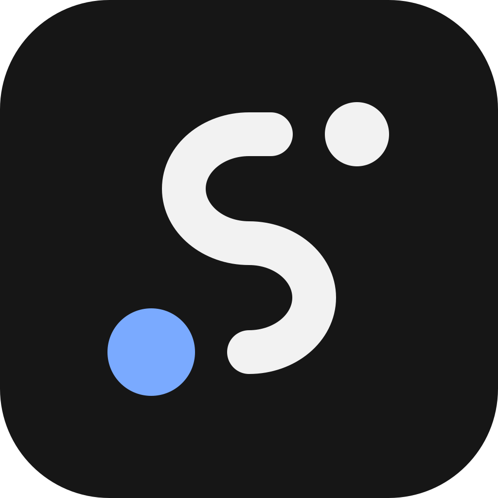

# Skipper logo

This page says what the Skipper logo is, what it means, which colours it uses, how much room it needs, how small it may be, and which file is for what. The picture files are in [`docs/brand/`](brand/): the SVG masters, the PNG sizes, the Windows icon, the favicon files and the images for the social accounts. The pixel files that the program itself uses are in `crates/skipper-app/assets/icon/` (it follows with the code; documents first).

## Name and logo

This section says who may use the name Skipper and the logo, and for what. It is the maintainer's rule for this project, not legal advice, and Skipper is not a registered trademark.

- **Licence of the logo files.** The logo files in [`docs/brand/`](brand/) are part of this repository and are covered by the MIT licence in [`LICENSE`](../LICENSE), like the rest of it. You may copy and modify the files, for example to write about Skipper or to build a fork. The licence covers the files only. It gives no right to use the name or the logo in a way that implies a connection with the project.
- **Unmodified builds.** A build keeps the name Skipper and the logo only if it is an unmodified build made from this repository's source, and only the builds on this repository's Releases page are releases of this project.
- **Changed builds and forks.** A build whose code, behaviour or look differs from this repository's source uses another name and another logo. It may say that it is "based on Skipper" or "a fork of Skipper".
- **No implied endorsement.** Nobody may suggest that the project, its maintainer or Anthropic endorses, sponsors or runs their software, site, service or social account, for example by a name, a logo, a domain or an account name that looks official.
- **Claude and Anthropic.** Skipper is independent and is not affiliated with, endorsed by or sponsored by Anthropic. Claude and Claude Code are trademarks of Anthropic. They never appear in Skipper's name or logo (see rule 11 of [`CONTRIBUTING.md`](../CONTRIBUTING.md)).

## What it shows

The logo is called the "Route-S". It is one S-shaped route line, a large blue dot at the bottom left and a small light dot at the top right, on a dark rounded square.

- The blue dot at the bottom left is the start. It stands for you.
- The line is the planned route.
- The light dot at the top right is the goal.

The meaning belongs to the positions as well as the colours. The blue dot always stays at the bottom left, and the light dot always stays at the top right.

## Colours

| Role | Colour | Where |
|---|---|---|
| Plate | `#161616` | The background of the app icon. |
| Mark on dark | `#F2F2F2` | The route line and the goal dot, on the plate and on other dark backgrounds. |
| Start dot on dark | `#7AAAFF` | The blue start dot, on the plate and on other dark backgrounds. |
| Mark on light | `#1B1B1B` | The route line and the goal dot on light backgrounds (the mark without its plate). |
| Start dot on light | `#1F5FD6` | The blue start dot on light backgrounds. It is the "working" blue of the light theme of the app. |

### Contrast

The numbers are the contrast ratios of the WCAG 2.x guidelines: (L1 + 0.05) / (L2 + 0.05), where L1 is the relative luminance of the lighter colour and L2 that of the darker one. The luminances are 0.4011 for `#7AAAFF`, 0.1333 for `#1F5FD6`, 0.8879 for `#F2F2F2`, 0.0110 for `#1B1B1B`, 0.0080 for `#161616`, 0.8963 for `#F3F3F3` and 1.0000 for `#FFFFFF`. A mark needs at least 3 : 1 against its background to count as clearly visible.

| Pair | Ratio | Result |
|---|---|---|
| `#F2F2F2` on the plate `#161616` | 16.16 : 1 | Passes. |
| `#7AAAFF` on the plate `#161616` | 7.77 : 1 | Passes (3 : 1 and 4.5 : 1). |
| `#7AAAFF` on `#F3F3F3` | 2.10 : 1 | Fails 3 : 1. Never use it on a light background. |
| `#7AAAFF` on `#FFFFFF` | 2.33 : 1 | Fails 3 : 1. Never use it on a light background. |
| `#1F5FD6` on `#F3F3F3` | 5.16 : 1 | Passes (3 : 1 and 4.5 : 1). |
| `#1F5FD6` on `#FFFFFF` | 5.73 : 1 | Passes (3 : 1 and 4.5 : 1). |
| `#1B1B1B` on `#F3F3F3` | 15.52 : 1 | Passes. |
| `#1B1B1B` on `#FFFFFF` | 17.22 : 1 | Passes. |

The blue start dot differs from the light mark more by hue than by brightness: `#7AAAFF` against `#F2F2F2` is only 2.08 : 1. That is why its position carries the meaning as well as its colour.

## How it is drawn

The app icon is drawn on a grid of 1024 by 1024 units:

- The plate is the full square with a corner radius of 225 units, colour `#161616`.
- The route line is the path `M557 276H512A134 112 0 0 0 512 500A134 112 0 0 1 512 724` with a stroke width of 90, round ends and the colour `#F2F2F2`.
- The goal dot has its centre at (734, 276), a radius of 66 and the colour `#F2F2F2`.
- The start dot has its centre at (311, 724), a radius of 90 and the colour `#7AAAFF`.

The mark without a plate fills its grid more: the route is `M568 216H512A168 140 0 0 0 512 496A168 140 0 0 1 512 776` with a stroke width of 112, the goal dot has a radius of 84 at (788, 216), and the start dot has a radius of 112 at (264, 776).

## Clear space

Keep at least the radius of the large start dot free on every side of the logo.

- For the app icon that is 90 units on its 1024 grid, about 9 % of the width of the plate, measured from the edge of the plate.
- For the mark without a plate it is 112 units on its 1024 grid, about 16 % of the width of the mark, measured from the outermost edge of the mark.

## Minimum sizes

- App icon below 40 pixels: use the hand-drawn small files (`skipper-icon-16.svg` to `skipper-icon-32.svg`). 16 pixels is the smallest size. Do not scale `skipper-icon.svg` or a large picture down to those sizes.
- App icon from 40 pixels up: `skipper-icon.svg`.
- The mark without a plate: at least 32 pixels wide. Below that, use the app icon.

## Files

This section says which file is for what. All of them are in [`docs/brand/`](brand/):

| Folder or file | What it holds |
|---|---|
| `docs/brand/*.svg` | The 11 SVG masters of the logo (see "SVG masters" below). |
| `docs/brand/png/` | The app icon as PNG files in 15 sizes from 16 to 2048 pixels, and the mark alone in 6 sizes from 64 to 2048 pixels, for dark and for light backgrounds. |
| `docs/brand/skipper.ico` | A Windows icon file with eight images. |
| `docs/brand/favicon/` | The favicon for a web site, and the touch icon for an iPhone or iPad home screen. |
| `docs/brand/social/` | The images for the social accounts: X, Discord, GitHub, LinkedIn and the link preview of a web page. |
| `docs/brand/social/src/` | The SVG source of every image in `social/`. |
| `docs/brand/readme/` | The eight pictures of the README's front page: the hero banner in a dark and a light version, and six small icons. They are drawings for the README, not logo masters. |

The SVG files are the masters for any other size: render a new size from the SVG, and never scale a PNG file up. The PNG and icon files of the logo were rendered from these masters, and the social images from the SVG files in `social/src/`. None of the logo and social pictures holds text or hidden data (no text chunks, no EXIF block, no author or tool name), and none holds a path, a name or an address. The pictures in `readme/` are the one place that holds text: the banner draws the word Skipper and its tagline as SVG text.

### SVG masters

Every SVG here is plain SVG 1.1 made of paths, circles and rectangles only: no text, no filters, no scripts and no style sheets. The file in `favicon/` follows the same rule. The files in `social/src/` use the same shapes, and fourteen of the nineteen also use a plain `g` group, which only moves and scales them.

| File in `docs/brand/` | Use |
|---|---|
| `skipper-icon.svg` | The app icon in colour, 1024 by 1024: dark plate, light route and goal, blue start. The main logo file, and the one the README shows. |
| `skipper-icon-mono.svg` | The app icon with every mark in the light colour and no blue, for places where colour is not available. |
| `skipper-icon-square.svg` | The same as `skipper-icon.svg`, but with a square plate that fills the whole picture and has no rounded corners. For a platform that rounds the corners itself. |
| `skipper-mark-dark.svg` | The mark alone, without the plate, for dark backgrounds: light line and goal, blue start (`#7AAAFF`). |
| `skipper-mark-light.svg` | The mark alone for light backgrounds: near-black line and goal, darker blue start (`#1F5FD6`). |
| `skipper-mark-mono-dark.svg` | The mark alone, all light, for one-colour use on dark backgrounds. |
| `skipper-mark-mono-light.svg` | The mark alone, all near-black, for one-colour use on light backgrounds (stamps, print, photocopies). |
| `skipper-icon-16.svg` | Hand-drawn for 16 pixels: a title bar or a browser tab at 100 % scaling. |
| `skipper-icon-20.svg` | Hand-drawn for 20 pixels: a title bar at 125 % scaling. |
| `skipper-icon-24.svg` | Hand-drawn for 24 pixels: a title bar at 150 % scaling. |
| `skipper-icon-32.svg` | Hand-drawn for 32 pixels: a title bar at 200 % scaling, a sharper browser tab. |

The four hand-drawn files are not scaled-down copies of the master. At these sizes the line is thicker, the drawing fills more of the plate, and the straight parts and the edges of the dots sit on the pixel grid. So the route and both dots stay sharp, and the blue start dot stays round.

### PNG files: `docs/brand/png/`

All files here have straight (not premultiplied) alpha and are transparent outside the rounded plate or outside the mark. The pixels are plain sRGB values.

| File | Use |
|---|---|
| `skipper-icon-16.png`, `-20`, `-24`, `-32` | The app icon at the four small sizes, rendered from the hand-drawn SVG files. |
| `skipper-icon-40.png`, `-48`, `-64`, `-96`, `-128`, `-180`, `-192`, `-256`, `-512`, `-1024` | The app icon, rendered from `skipper-icon.svg`. 192 and 512 are the sizes that the manifest of a web app asks for. 1024 is the size for a store listing and for large formats. For the home screen of an iPhone use `favicon/apple-touch-icon.png`, which has no transparent corners. |
| `skipper-icon-2048.png` | The app icon at 2048 by 2048 pixels, rendered straight from `skipper-icon.svg`, not scaled up from the 1024 file. For posters, large print, press kits and every place that asks for a source of high resolution. |
| `skipper-mark-dark-64.png`, `-128`, `-256`, `-512`, `-1024`, `-2048` | The mark alone, without the plate, for dark backgrounds. |
| `skipper-mark-light-64.png`, `-128`, `-256`, `-512`, `-1024`, `-2048` | The mark alone for light backgrounds. |

The same rules for small sizes apply as above: below 40 pixels take the app icon in its hand-drawn size, and the mark alone needs at least 32 pixels.

### Windows icon: `docs/brand/skipper.ico`

One icon file with eight images, at 16, 20, 24, 32, 40, 48, 64 and 256 pixels, each one a PNG-compressed picture with colour and alpha (Windows Vista and later read this for every size, including Windows 10 and 11). The images at 16 to 32 pixels are the hand-drawn ones, and the images from 40 pixels up come from the master. It is for a place outside the program that asks for an `.ico` file.

### Favicon: `docs/brand/favicon/`

| File | Use |
|---|---|
| `favicon.ico` | The icon of a browser tab, with the images at 16, 32 and 48 pixels. |
| `favicon.svg` | The colour app icon as a vector favicon. It is the same file as `skipper-icon.svg`. |
| `apple-touch-icon.png` | 180 by 180 pixels, with a square plate that fills the whole picture, for the home screen of an iPhone or iPad. The system rounds the corners itself. |

### Social images: `docs/brand/social/`

The images are opaque PNG files in exact pixel sizes. They hold no text, because X, Discord, GitHub and LinkedIn show the name of the account, the server or the repository next to the image.

| File | Pixels | Use |
|---|---|---|
| `x-avatar-400.png` | 400 by 400 | The profile photo of the account on X. |
| `x-header-1500x500-a.png`, `-b`, `-c` | 1500 by 500 | The header of the account on X. |
| `x-header-3000x1000-a.png`, `-b`, `-c` | 3000 by 1000 | The same header at exactly double size, for screens of high density. |
| `discord-icon-512.png` | 512 by 512 | The icon of the Discord server. |
| `discord-banner-960x540-a.png`, `-b`, `-c` | 960 by 540 | The banner of the Discord server. The server needs boost level 2 to show a banner. |
| `discord-banner-1920x1080-a.png`, `-b`, `-c` | 1920 by 1080 | The same banner at exactly double size. The server needs boost level 2. |
| `github-social-preview-1280x640.png` | 1280 by 640 | The social preview of the GitHub repository. A repository admin sets it under Settings > Social preview (a PNG, JPG or GIF under 1 MB). It is also the picture that a link card shows for the repository. |
| `og-image-1200x630.png` | 1200 by 630 | The link preview (Open Graph picture, `og:image`) of a web page, for the link cards of X, LinkedIn, Slack, Discord and others. |
| `linkedin-banner-1584x396.png` | 1584 by 396 | The banner of a profile or a company page on LinkedIn. |
| `avatar-1024.png`, `avatar-2048.png` | 1024 by 1024, 2048 by 2048 | The avatar masters, for any other slot that asks for a profile photo. The 2048 file is the 1024 one at double size. |

- Avatars are cropped round by X and Discord, so in the three avatar files the mark stays inside the circle: its outermost point, the edge of the goal dot, lies at about 0.75 of the radius of the circle.
- Variant `a` is the mark alone. Variant `b` is the route: the blue start dot at the lower left, one route line, and the light goal dot at the upper right. Variant `b` is drawn in the grammar of the logo, with its proportions of line and dots. It is not the logo stretched.
- Variant `c` shows the mark large and centred, for a profile banner where the logo should be big: the X header (1500 by 500 and 3000 by 1000) and the Discord server banner (960 by 540 and 1920 by 1080). The mark is the logo unchanged, with no line or text added. On X the lower left corner stays free for the profile photo. Discord draws the name of the server over the banner, so check the banner in the preview of the server settings in Discord, and use variant `a` or `b` if the name collides with the mark.
- The headers keep every shape between y = 75 and y = 425 of the 1500 by 500 picture (between y = 150 and y = 850 of the 3000 by 1000 picture), because X crops the top and the bottom on some phones, and the profile photo covers the lower left.
- The lower left of the banners `a` and `b` stays empty, because Discord shows the name of the server there. Banner `c` is centred and large instead, so its blue start dot lies in the lower left.
- The GitHub preview and the link preview keep every shape inside a centred safe area of 1100 by 560 pixels, because a link card may crop them to a ratio of about 1.91 : 1. On LinkedIn the round profile photo covers the lower left, so nothing lies left of x = 400.

### Social image sources: `docs/brand/social/src/`

One plain SVG file for every image in `social/`, with the same name and the ending `.svg`. A file that is an image at double size holds the shapes of its single-size source in a group scaled by two. To change an image or to make another size, edit or copy the SVG file and render it again; the SVG files are the masters.

### README pictures: `docs/brand/readme/`

Eight hand-written SVG files for the front page of the README. They are plain SVG 1.1 with no script, no style sheet, no link and no outside image, and they load no font file.

| File | Use |
|---|---|
| `hero-dark.svg`, `hero-light.svg` | The banner at the top of the README, 1280 by 400 units, in a dark and a light version. The README picks one through a `picture` element by the colour scheme of the reader. Both draw the word Skipper, the tagline and a status line as SVG text in the system's own sans-serif fonts (so the letters differ a little from one PC to the next), and a wide route in the style of the social images: one line of straight stubs and half-ellipse arcs with round ends, a blue start dot at the lower left and a goal dot at the upper right, with the stroke, goal dot and start dot in the proportion 16 : 12 : 16 and a gap between each line end and its dot equal to the goal dot's radius. Dark: plate `#161616`, route, goal dot and name `#F2F2F2`, start dot `#7AAAFF`. Light: plate `#F3F3F3`, route, goal dot and name `#1B1B1B`, start dot `#1F5FD6`. The two smaller lines of text have a contrast of at least 6 : 1 to their plate, the name and the route a contrast of at least 15 : 1. |
| `icon-terminal.svg`, `icon-board.svg`, `icon-limits.svg`, `icon-approve.svg`, `icon-account.svg`, `icon-native.svg` | The six small icons of the cards under "At a glance", each 96 by 96 units on the dark rounded plate `#161616`, with a light line `#F2F2F2` and one blue accent `#7AAAFF`. The plate is the same in both colour schemes, so each icon exists once. They are plain drawings (a terminal window, a board, a gauge, a check mark, a person, a chip); none copies the logo of Windows, Rust or any other product. |

The tests of the public documents, `crates/skipper-core/tests/public_docs.rs` (it follows with the code; documents first), check that these files exist, hold no script or link, and keep their text at a contrast of at least 4.5 : 1 and their shapes at 3 : 1.

### In the program

The program holds the logo as raw pixels (four bytes for each pixel: red, green, blue and alpha, rows from the top), in `crates/skipper-app/assets/icon/` (it follows with the code; documents first):

| File | Use |
|---|---|
| `skipper-256.rgba` | The logo at 256 by 256 pixels. Every window of Skipper is given it as its icon, and the icon of `skipper.exe` holds it. The sidebar mark scales it down where no hand-drawn size reaches. |
| `skipper-16.rgba`, `skipper-20.rgba`, `skipper-24.rgba`, `skipper-32.rgba` | The hand-drawn small sizes. The icon of `skipper.exe` holds these pixels exactly as drawn at 16, 20, 24 and 32 pixels. The sidebar mark and the small icon of the title bar of the main window show the one whose size matches, or else the next larger hand-drawn one, scaled down (the 32 pixel one at a Windows scaling of 175 %). |

The icon of `skipper.exe` has eight images: 16, 20, 24 and 32 pixels from the hand-drawn files, 40, 48 and 64 pixels averaged down from the 256 pixel logo, and the 256 pixel logo itself.

### Where the program shows the logo

| Place | What it shows |
|---|---|
| Explorer, shortcuts and the properties of the file | The icon of `skipper.exe`, with its eight images. Windows takes the size it needs from them. |
| The mark at the top of the sidebar, beside the name Skipper | The logo as a picture, in the same colours in the light and the dark theme. It is 16 points wide at Windows' normal text size (a larger "Text size" in Windows makes it larger, and the picture follows). It shows the hand-drawn picture whose size matches the mark on the screen: 16 pixels at a Windows scaling of 100 %, 20 at 125 %, 24 at 150 % and 32 at 200 %. Between those it shows the next larger hand-drawn picture, scaled down: at 175 % the mark is 28 pixels wide and shows the 32 pixel picture. Where the mark is wider than 32 pixels (above 200 %, for example 225 % or 250 %) it shows the 256 pixel logo, scaled down. |
| The small icon of the title bar of the main window | The hand-drawn picture of the title bar's icon size in the same way: 16, 20, 24 or 32 pixels at 100, 125, 150 or 200 %, and at 175 % the 32 pixel picture, which Windows scales to the 28 pixels it wants. Skipper sets it once the window has had the focus, and again when the window moves to a screen that needs another size. Before that, and above 200 % (for example 225 % or 250 %), the title bar shows the icon that the window library makes from the 256 pixel logo. |
| The taskbar button of the running program | The icon that the window library makes from the 256 pixel logo, not a hand-drawn size. |
| The windows that you detach from the terminal panels, the window that reports a fatal error, and the preview program | The 256 pixel logo, which Windows scales for the title bar. They get no hand-drawn small icon (a known limit). |

If a window stands on a screen whose scaling differs from the scaling of Windows itself, Windows scales the picture it was given to the size it wants, so the title bar's picture may not match exactly. The tests check which picture is chosen and when it is sent. That Windows then shows the pictures as this table says rests on a reading of the code of the window libraries, not on a look at a real screen.

## Using the logo

This list is the project's own usage rule for builds that carry the name Skipper. A modified build or fork follows the name rule in "Name and logo" above instead.

Do:

- Use the colour app icon wherever a square icon is needed.
- Use `skipper-mark-dark.svg` on dark backgrounds and `skipper-mark-light.svg` on light backgrounds, so that the blue start dot keeps at least 3 : 1 contrast.
- Use the one-colour files when only one colour is available.
- Keep the blue dot as the start at the bottom left and the light dot as the goal at the top right.
- Keep the background behind the mark calm and flat.

Do not:

- Recolour the line or the goal dot, or use another blue for the start dot.
- Rotate, mirror, skew or stretch the logo.
- Add outlines, shadows, glows or gradients.
- Place it on busy backgrounds, photos or patterns.
- Swap the dots, move the blue dot, or turn the start dot into a second goal.
- Put text inside the plate or redraw the route.
- Use `#7AAAFF` on a light background.
